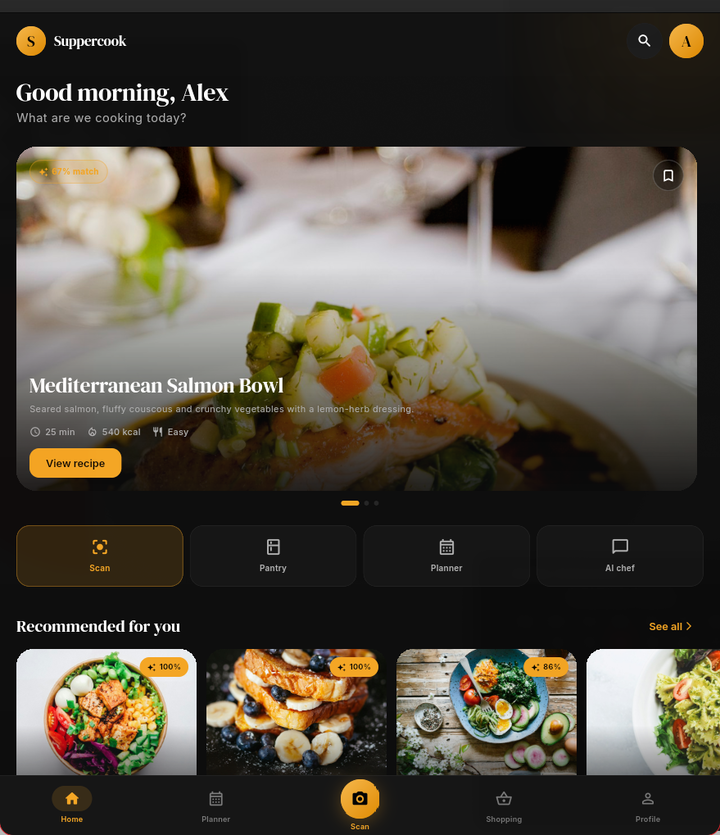

# Suppercook

A cooking app built around one question: **what can I make with what's already in my kitchen?**

You add or scan your ingredients, get recipes that mostly fit, and the shopping list only includes the things you're actually missing. There's a weekly planner and a step-by-step cooking mode too.

The client is Flutter (Linux, Android, iOS), the backend is NestJS. It's a work in progress: the UI is fully clickable, but AI recognition, the chat and auth are still mocked.



## Where things stand

I started with a React Native/Expo prototype and a small NestJS API, then rebuilt the client in Flutter because I wanted one codebase that also runs natively on Linux. The old RN app is still in `apps/mobile`; the Flutter app in `apps/mobile_flutter` is the one I'm working on now.

What works today:

- onboarding, profile, diet/allergy preferences and calorie target
- pantry, smart shopping list and weekly planner, persisted locally
- scan flow with camera/gallery on mobile and file upload on desktop
- recipe list, recipe detail, cooking mode and per-serving macros
- EN/DE localization with instant switching
- mock ingredient recognition and mock AI chat

What's still fake or missing:

- photo recognition returns a fixed demo result
- the AI chat answers from a template
- login is a stub, there are no real accounts
- the API keeps everything in memory; restarting it clears the data
- the weekly plan is local only and isn't synced anywhere
- community features aren't started

## Try the Android build

The latest APK is on the Releases page:

**[Download Suppercook 0.1.0 (APK)](https://github.com/yurei07/suppercook/releases/download/v0.1.0-mvp/Suppercook-0.1.0-mvp.apk)**

It's debug-signed, so Android will ask you to allow installs from unknown sources. It's also a universal APK, which is why it's around 57 MB.

## Run from source

### Flutter client

```bash
cd apps/mobile_flutter
flutter pub get
flutter run -d linux       # Linux desktop
flutter run -d android     # Android
flutter run -d ios         # iOS, macOS + Xcode only
```

On Linux you need the usual desktop toolchain: `clang`, `cmake`, `ninja`, `gtk3` and `pkg-config`. On Arch:

```bash
sudo pacman -S clang cmake ninja gtk3 pkgconf
```

Android SDK setup and APK signing notes are in
[`apps/mobile_flutter/docs/ANDROID_BUILD.md`](apps/mobile_flutter/docs/ANDROID_BUILD.md).

### API

```bash
npm install
npm run api
```

It starts on `http://localhost:3000`. No OpenAI key is required; without one it uses the mock provider. If you want real generation, copy `apps/api/.env.example` to `.env`, set `AI_PROVIDER=openai` and add your key.

Quick check:

```bash
curl http://localhost:3000/health
curl -X POST http://localhost:3000/recipes/suggest \
  -H 'Content-Type: application/json' \
  -H 'x-user-id: demo' \
  -d '{"locale":"en"}'
```

## Repo layout

```
apps/
  api/              NestJS backend: inventory, recipes, shopping list, AI layer
  mobile_flutter/   active Flutter client
  mobile/           first React Native/Expo prototype, kept for reference
docs/               product notes and early architecture docs (mostly Russian)
```

## A few implementation notes

**Flutter.** Riverpod for state, go_router for navigation, feature-first folders. The desktop layout swaps the bottom bar for a side rail at 900 px. Pantry, shopping list and planner are stored as JSON in SharedPreferences; the repository layer for the API is next.

**Localization.** English and German live in ARB files and switch without restarting the app. Recipe and ingredient content from the API is localized on the server via a `locale` field (`en`/`de`), so the client doesn't have to translate anything itself.

**Look.** Dark background, orange accent, DM Serif Display for dish names and Inter for UI. Fonts are bundled, not downloaded at runtime. The food photos are from Unsplash and are only demo content — see [`apps/mobile_flutter/assets/ATTRIBUTION.md`](apps/mobile_flutter/assets/ATTRIBUTION.md).

**API.** NestJS with DTO validation and zod checks on model output. Recipes get an `image` key that the client maps to a local asset. Allergens are filtered in code, not in the prompt; missing ingredients are calculated on the server. The cache key includes locale and diet. Storage is still in-memory, so this is not production-ready.

A few endpoints you'll probably touch first:

### Endpoints

| Method | Path | What it does |
|---|---|---|
| GET | `/inventory` | list pantry items |
| POST | `/inventory` | add an item |
| PATCH / DELETE | `/inventory/:id` | update / remove |
| POST | `/inventory/recognize` | photo → ingredient suggestions |
| POST | `/recipes/suggest` | recipes from the pantry |
| GET | `/shopping` | shopping list |
| POST | `/shopping/from-recipe` | add only missing ingredients |
| PATCH / DELETE | `/shopping/items/:id` | toggle checked / remove |

`x-user-id` is a temporary stand-in for authentication. Pass `locale: "en"` or `"de"` to recognition and recipe requests.

## Tests

```bash
# backend
cd apps/api && npm test

# Flutter
cd apps/mobile_flutter
flutter analyze
flutter test
```

The backend currently has 24 tests. The Flutter side covers live language switching and local persistence of the pantry, shopping list and planner.

## Known rough edges

- The universal APK includes three ABIs and is larger than it needs to be. Split APKs will fix that later.
- The Linux build has no camera support, so scanning means uploading a file.
- The planner is demo content; there's no "generate a balanced week" logic yet.
- The recipe catalog is small and hand-written.
- No CI yet. Tests are run locally.
- The app has only been tested on Linux and a clean Android device, not on iOS hardware.

## Next

- [ ] Replace the Flutter mock data with an API repository (`dio`, loading/error states, offline fallback).
- [ ] Move the API from in-memory maps to PostgreSQL + Prisma.
- [ ] Add real authentication and remove `x-user-id`.
- [ ] Connect OpenAI vision and generation with budget limits.
- [ ] Add CI and a proper release keystore.
- [ ] Community features: recipe feed, chat, moderation.

## Credits

Fonts: [DM Serif Display](https://fonts.google.com/specimen/DM+Serif+Display) and [Inter](https://rsms.me/inter/), both under the SIL Open Font License.
Photos: [Unsplash](https://unsplash.com/license), used as demo content. The full list is in `apps/mobile_flutter/assets/ATTRIBUTION.md`.

If you find a bug or want to suggest something, open an issue. I'm building this in public and the rough edges are part of the process.
