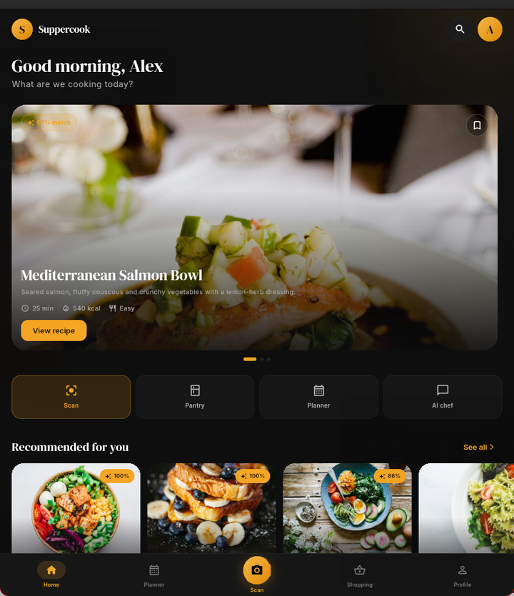

# Suppercook

A cooking app built around one question: **what can I make with what's already in my kitchen?**

You add or scan your ingredients, get recipes that mostly fit, and the shopping list only includes the things you're actually missing. There's a weekly planner and a step-by-step cooking mode too.

The client is Flutter (Linux, Android, iOS), the backend is NestJS. It's a work in progress: the UI is fully clickable, but AI recognition, the chat and auth are still mocked.



## Where things stand

I started with a React Native/Expo prototype and a small NestJS API, then rebuilt the client in Flutter because I wanted one codebase that also runs natively on Linux. The old RN app is still in `apps/mobile`; the Flutter app in `apps/mobile_flutter` is the one I'm working on now.

What works today:

- onboarding, profile, diet/allergy preferences and calorie target
- pantry, smart shopping list and weekly planner, persisted locally
- the weekly planner syncs with the API in Live API mode (meals push up as full recipe snapshots, so the plan survives restarts)
- scan flow with camera/gallery on mobile and file upload on desktop
- recipe list, recipe detail, cooking mode and per-serving macros
- saved recipes (favorites) with a dedicated screen, synced with the API as full recipe snapshots; cooking history is recorded on the server too
- EN/DE localization with instant switching
- email/password accounts: register and sign in against the API, the session token is stored on the device and every Live API request carries it as a Bearer token
- Live API mode for recipe suggestions, photo recognition and the shopping list (Profile → Data source)
- mock ingredient recognition and mock AI chat in demo mode

What's still fake or missing:

- photo recognition returns a fixed demo result (Live API or not — the backend uses the mock provider without an OpenAI key)
- the AI chat answers from a template
- sign-in with Apple/Google isn't there at all (the fake buttons got removed until it's real); the JWT lives in SharedPreferences rather than the system keystore
- the cooking history is a counter plus server entries; there's no per-day history UI yet
- the API persists to a local SQLite file; PostgreSQL is the production target
- Live API covers recipes, photo recognition, the shopping list and the planner; offline edits made while the API is down are not merged back yet
- pantry sync is two-way in Live API mode, but the merge is additive: items missing locally are pulled from the server, existing ones are never overwritten
- community features aren't started

## Try the Android build

The latest APK is on the Releases page:

**[Download Suppercook 0.1.0 (APK)](https://github.com/yurei07/suppercook/releases/download/v0.1.0-mvp/Suppercook-0.1.0-mvp.apk)**

It's debug-signed, so Android will ask you to allow installs from unknown sources. It's also a universal APK, which is why it's around 57 MB.

## Run from source

### Flutter client

```bash
cd apps/mobile_flutter
flutter pub get
flutter run -d linux       # Linux desktop
flutter run -d android     # Android
flutter run -d ios         # iOS, macOS + Xcode only
```

On Linux you need the usual desktop toolchain: `clang`, `cmake`, `ninja`, `gtk3` and `pkg-config`. On Arch:

```bash
sudo pacman -S clang cmake ninja gtk3 pkgconf
```

Android SDK setup and APK signing notes are in
[`apps/mobile_flutter/docs/ANDROID_BUILD.md`](apps/mobile_flutter/docs/ANDROID_BUILD.md).

### API

```bash
npm install
npm run prisma:push   # creates the SQLite dev database (first run only)
npm run api
```

It starts on `http://localhost:3000`. No OpenAI key is required; without one it uses the mock provider. If you want real generation, copy `apps/api/.env.example` to `.env`, set `AI_PROVIDER=openai` and add your key. Set `JWT_SECRET` in `.env` before exposing the API anywhere beyond localhost.

NixOS users: `nix-shell` at the repo root gives you Node 24 plus the Prisma engines binaries.prisma.sh doesn't ship for nixos (see `shell.nix`).

Then open the app, go to **Profile → Data source → Live API**. Recipe suggestions and photo recognition will go through the backend. The Android emulator reaches your machine at `10.0.2.2`; for a physical phone build with your LAN address:

```bash
flutter build apk --release \
  --dart-define=SUPPERCOOK_API_URL=http://192.168.1.20:3000
```

Quick check:

```bash
curl http://localhost:3000/health
curl -X POST http://localhost:3000/recipes/suggest \
  -H 'Content-Type: application/json' \
  -H 'x-user-id: demo' \
  -d '{"locale":"en"}'
```

## Repo layout

```
apps/
  api/              NestJS backend: inventory, recipes, shopping list, AI layer
  mobile_flutter/   active Flutter client
  mobile/           first React Native/Expo prototype, kept for reference
docs/               product notes and early architecture docs (mostly Russian)
```

## A few implementation notes

**Flutter.** Riverpod for state, go_router for navigation, feature-first folders. The desktop layout swaps the bottom bar for a side rail at 900 px. Pantry, shopping list and planner are stored as JSON in SharedPreferences; the repository layer for the API is next.

**Localization.** English and German live in ARB files and switch without restarting the app. Recipe and ingredient content from the API is localized on the server via a `locale` field (`en`/`de`), so the client doesn't have to translate anything itself.

**Look.** Dark background, orange accent, DM Serif Display for dish names and Inter for UI. Fonts are bundled, not downloaded at runtime. The food photos are from Unsplash and are only demo content — see [`apps/mobile_flutter/assets/ATTRIBUTION.md`](apps/mobile_flutter/assets/ATTRIBUTION.md).

**API.** NestJS with DTO validation and zod checks on model output. Recipes get an `image` key that the client maps to a local asset. Allergens are filtered in code, not in the prompt; missing ingredients are calculated on the server. The cache key includes locale and diet. Inventory and the shopping list live in a SQLite database through Prisma (PostgreSQL is the production target), so data survives restarts.

A few endpoints you'll probably touch first:

### Endpoints

| Method | Path | What it does |
|---|---|---|
| GET | `/health` | status + DB check |
| POST | `/auth/register` | create an account, returns a JWT |
| POST | `/auth/login` | email + password → JWT |
| GET | `/auth/me` | current profile (Bearer token) |
| GET | `/inventory` | list pantry items |
| POST | `/inventory` | add an item |
| PATCH / DELETE | `/inventory/:id` | update / remove |
| POST | `/inventory/recognize` | photo → ingredient suggestions |
| POST | `/recipes/suggest` | recipes from the pantry |
| GET | `/recipes/saved` | saved recipes (full snapshots) |
| PUT / DELETE | `/recipes/saved/:recipeId` | save / unsave |
| GET | `/recipes/cooked` | cooking history |
| POST | `/recipes/cooked` | record a cooked meal |
| GET | `/planner?week=YYYY-MM-DD` | meals for the week |
| PUT | `/planner/meals` | put a recipe into a day slot |
| PUT | `/planner` | replace the whole week |
| POST | `/planner/generate` | build a balanced week from a recipe pool |
| DELETE | `/planner/meals?week&day&slot` | clear a slot |
| GET | `/shopping` | shopping list |
| POST | `/shopping/from-recipe` | add only missing ingredients |
| PATCH / DELETE | `/shopping/items/:id` | toggle checked / remove |

Authentication: send `Authorization: Bearer <jwt>` from `/auth/register` or `/auth/login`. The legacy `x-user-id` header is still accepted for guests (the app uses it in demo mode). AI endpoints (`/recipes/suggest`, `/inventory/recognize`) have a per-user daily limit (`AI_DAILY_LIMIT`, default 20) and return 429 when it's exhausted; token usage per user per day is tracked in the database, and rate limiting is 120 req/min globally and 10 req/min on AI and auth endpoints.

## Tests

```bash
# backend
cd apps/api && npm test

# Flutter
cd apps/mobile_flutter
flutter analyze
flutter test
```

The backend currently has 67 tests (auth, quota, planner, saved recipes, services, units, images) and an eslint gate in CI. The Flutter side covers live language switching, local persistence and the sync providers (25 tests).

## Known rough edges

- The universal APK includes three ABIs and is larger than it needs to be. Split APKs will fix that later.
- The Linux build has no camera support, so scanning means uploading a file.
- The planner now generates for real: in Live API mode the server composes a balanced week from your recipe pool (breakfast-tagged recipes for breakfast, no same-day lunch/dinner duplicates, no back-to-back dinners)
- The recipe catalog is small and hand-written.
- Live API mode uses plain HTTP for local development; production needs HTTPS and a proper network security config.
- CI runs on GitHub Actions: API build + tests, Flutter analyze + tests.
- I've only run the app on Linux so far. The Android APK is built but hasn't been tested on a physical device yet.

## Next

- [x] API client/repository for recipes and photo recognition, with a Demo / Live API switch.
- [x] Prisma + SQLite persistence for inventory and shopping list (Postgres is the production target).
- [x] Shopping list syncs with the API in Live API mode (read, add, toggle, clear).
- [ ] Sync the planner with the API and add proper offline handling.
- [x] GitHub Actions CI (API tests, Flutter analyze and tests).
- [x] Email/password auth with JWT + per-user AI quota and rate limiting.
- [x] Flutter client: register/sign in with real tokens, sign out in the profile.
- [x] Planner syncs with the API (recipe snapshots); proper offline merge is still open.
- [ ] Move the API to PostgreSQL.
- [ ] Connect OpenAI vision and generation with token cost tracking.
- [ ] Release keystore and signed builds.
- [ ] Community features: recipe feed, chat, moderation.

## Credits

Fonts: [DM Serif Display](https://fonts.google.com/specimen/DM+Serif+Display) and [Inter](https://rsms.me/inter/), both under the SIL Open Font License.
Photos: [Unsplash](https://unsplash.com/license), used as demo content. The full list is in `apps/mobile_flutter/assets/ATTRIBUTION.md`.

If you find a bug or want to suggest something, open an issue. I'm building this in public and the rough edges are part of the process.
